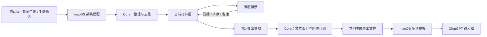

# 架构说明

## 两个模块

`ContextBasketApp` 负责用户界面和系统边界；`ContextBasketCore` 负责材料的含义、组织规则和导出计划。依赖方向为 App → Core。

初期保持单一仓库和两个编译模块。Swift Package Manager 的根清单在 M0 添加；本次初始化只有文档和目录，不包含实现。最低 macOS 版本在原型阶段根据 API 和可测试设备确定。

| 位置 | 职责 |
| --- | --- |
| App/App | 程序生命周期、菜单栏入口、服务组装、采集启停 |
| App/Features/Basket | 展示材料、处理预览/删除/排序/备注、呈现状态 |
| App/Platform/Clipboard | 剪贴板检查、读取可支持格式、隐藏标记处理、自身写入抑制 |
| App/Platform/Screenshots | 目录访问、文件变化监听、文件就绪判断 |
| App/Platform/DragAndDrop | 接收拖入内容、兑现文件承诺、建立多附件拖拽会话 |
| App/Platform/Windowing | NSPanel、焦点、窗口位置、多屏和全屏行为 |
| App/Platform/Persistence | 资产导入、原子写入索引、恢复、导出快照文件生命周期 |
| Core/Models | 材料、材料组、来源证据、导出快照的数据结构 |
| Core/Collection | 集合操作、去重策略、顺序管理、导出选择 |
| Core/Export | 固定快照的内容编排、文件名、context.txt、附件对应表 |

## 数据流

## 核心数据

| 对象 | 建议字段 / 约定 |
| --- | --- |
| ContextItem | id、kind、text 或 assetID、capturedAt、source、note；文本保留原文 |
| ContextSource | 采集途径、可证实的 URL/应用信息、来源可信程度；未知允许为空 |
| Basket | id、按顺序排列的 items、updatedAt；首版只有一个当前组 |
| Asset | id、相对文件名、格式、大小、校验值；原图独立于缩略图 |
| ExportSnapshot | id、创建时间、冻结的材料顺序和资产引用；导出开始后不变 |
| ExportPlan | context.txt 内容、文件名及材料映射、待附加资产 |

这些是实现约定，不代表已存在的 Swift 类型。类型细节在第一个实现 PR 中确定。

## 本地保存

建议使用应用专属的 Application Support 目录，分为 `basket.json`、`assets/` 和 `exports/`。JSON 带 schemaVersion 并采用原子替换；素材保存成功后才更新索引，异常恢复时检查缺失资产。

Core 只处理资产标识和导出计划。绝对路径、访问权限、文件复制以及清理属于 App 的 Persistence。用户原文件不会因删除篮内材料而被删除。

每次拖出生成独立快照目录。拖拽回调不能证明目标端已读取文件，因此不能在拖拽结束时立即删除导出文件；清理策略应在 M0 实测后确定，并保证重试可用。

## 交付策略

文字和链接写入 UTF-8 的 `context.txt`；图片使用带编号的文件名，作为独立附件。App 使用 AppKit 发起多项拖拽，Core 不感知 ChatGPT 窗口或浏览器。

初期导出流程保持通用。未来需要适配不同 Agent 时，以目标端已验证的格式和限制增加少量导出配置；出现实际差异前不引入插件框架。

## 边界与验证

- 材料数量和内容完整性、编号、导出顺序、去重规则由 Core 测试覆盖。
- 文件写入、恢复、导出资产存活期由 App 集成测试覆盖。
- 权限、焦点、真实跨应用拖拽和目标端理解通过人工实测覆盖。
- 剪贴板按变化读取的策略需要验证快速连续复制时的表现，不能默认无损。
- 系统拖拽完成、目标端附件出现、上传完成、AI 正确使用材料是不同状态，分别记录。
- 本次仓库初始化没有测试或构建结论；实现后再添加对应命令和自动检查。
